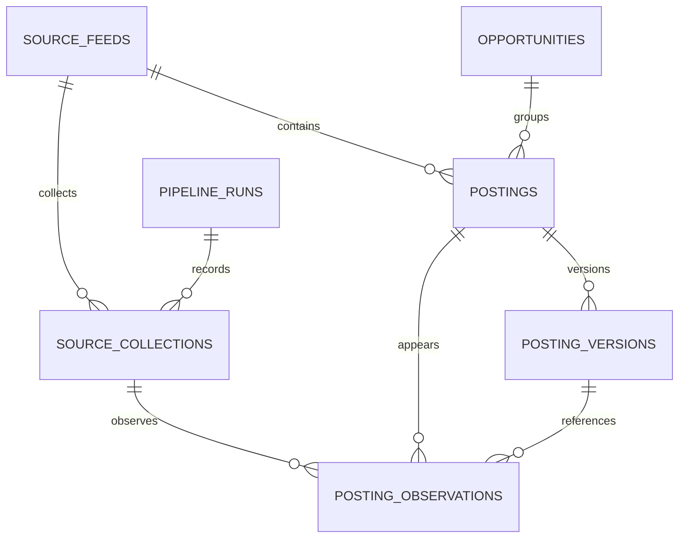
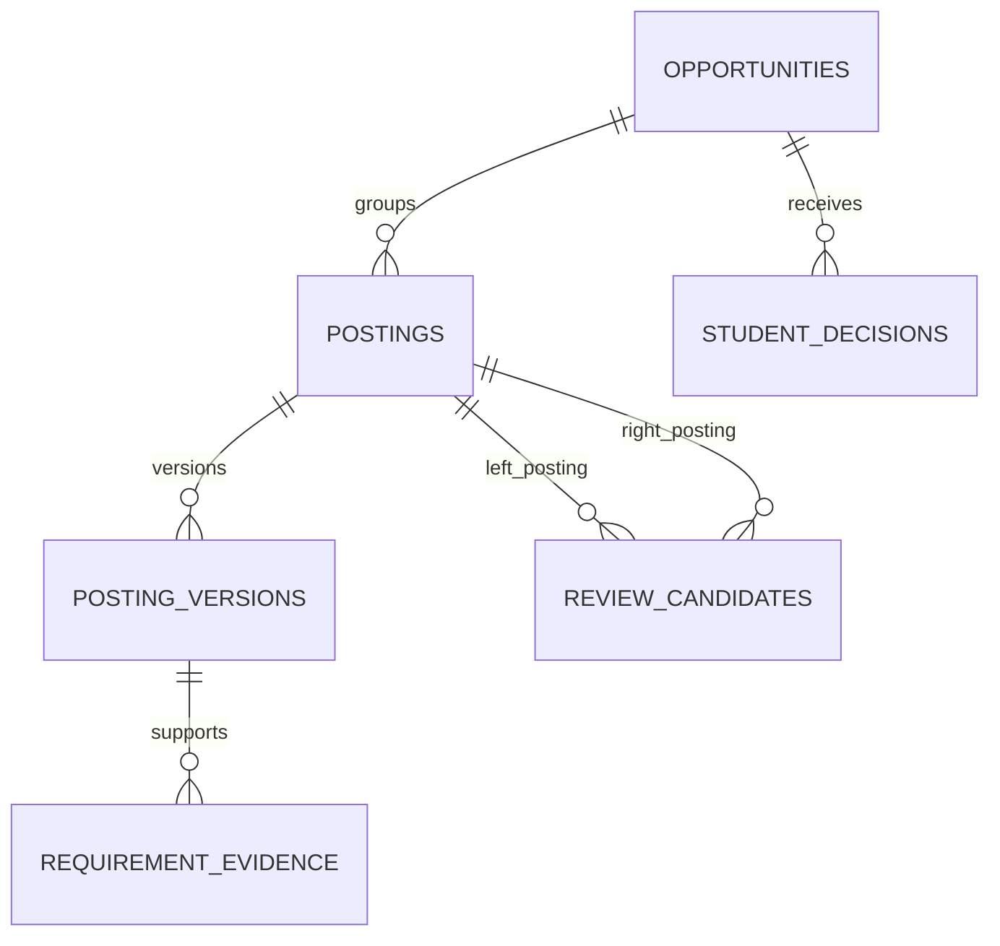

# Database design and querying

## Overview

Our PostgreSQL layer gives the pipeline memory across collections. It connects
several source listings to a shared opportunity, preserves the content seen in
each collection, and supports questions about new jobs, changed requirements,
uncertain duplicates, student follow-up, and source freshness. The implementation
is under [`sql/`](../sql/README.md); the existing Polars outputs remain the input
interface.

We distinguish a **source posting** from an **opportunity**. A Greenhouse posting
and a SimplifyJobs listing can point to the same opening while retaining their
separate source identities and evidence. We also distinguish a **version** from
an **observation**. An unchanged job can be observed in many runs while sharing
one stored content version.

## Entity relationship diagrams

Collection lineage and posting history:



Requirement evidence and review decisions:



## Tables and keys

All tables live in the `easyapply` schema. PostgreSQL timestamps use
`timestamptz`; ingestion timestamps must include a timezone.

| Table | One row represents | Primary key and relationships |
|---|---|---|
| `source_feeds` | A configured employer board or community repository | `feed_key`; unique `(source, feed_token)` |
| `pipeline_runs` | A collection batch and its database-load outcome | `run_id` |
| `source_collections` | One feed's collection outcome within a run | `(run_id, feed_key)`; references run and feed |
| `opportunities` | An upstream matched opportunity | `opportunity_key`; unique upstream `opportunity_id` |
| `postings` | A source's persistent posting identity | `posting_id`; unique `(source, external_id)`; references feed and opportunity |
| `posting_versions` | A distinct meaningful state of one posting | `version_id`; unique `(posting_id, state_hash)` |
| `posting_observations` | A posting observed in a collection | `(run_id, posting_id)`; references collection and the matching posting/version pair |
| `review_candidates` | An unordered pair of postings needing matching review | `(left_posting_id, right_posting_id)`; both reference postings |
| `requirement_evidence` | A skill mention or sponsorship statement supported by a version | `evidence_id`; references `version_id` |
| `student_decisions` | A student's latest decision about an opportunity | `(student_key, opportunity_key)`; references opportunity |

`schema_migrations` additionally records the filename, checksum, and application
time of each numbered SQL migration. The complete column types and constraints
are defined in [`001_schema.sql`](../sql/001_schema.sql).

### Important fields

| Table | Fields and meaning |
|---|---|
| `pipeline_runs` | `fetched_at` orders batches by collection time; `batch_hash` fingerprints the three input files; `status` is `loading`, `loaded`, or `failed`; counts and `error_type` support monitoring. |
| `source_collections` | `is_complete`, HTTP status, expected/received counts, error, raw `snapshot_path`, and checksum preserve the adapter's collection assessment. |
| `posting_versions` | Original and normalized company/title/location/URL, descriptions, ATS key, upstream `content_hash`, storage `state_hash`, role flag, source timestamps, and structured `extra` metadata. |
| `posting_observations` | Version reference, source `snapshot_path`, `source_updated_at`, complete `source_extra`, and the match method observed in that run. |
| `review_candidates` | Title similarity, location overlap, first/latest recorded runs, review status, reviewer, time, and notes. Pair IDs are stored in ascending order. |
| `requirement_evidence` | Attribute, value, literal excerpt, evidence field, and extraction method. Duplicate evidence for the same version is constrained. |
| `student_decisions` | `saved`, `applied`, `dismissed`, or `reviewed`; a signature of the opportunity state reviewed; decision time and optional notes. |

Company names are searchable normalized attributes, not global company identifiers.
The database does not merge employers merely because their normalized names match.

## Identity and historical behavior

We retain the upstream `(source, external_id)` posting identity and
`opportunity_key`/`opportunity_id` mapping. The upstream opportunity ID is the
first 16 hexadecimal characters of the SHA-1 of its identity key; the loader
validates this mapping. A changed identity assignment for an existing source
posting is rejected for review rather than silently moving student decisions.

The upstream `content_hash` detects title, location, and description changes.
Our `state_hash` additionally covers normalized searchable metadata, publication
time, role classification, and source-specific attributes such as sponsorship.
Formatting-only HTML changes and collection timestamps do not create versions.
The GitHub repository's `commit_sha` is lineage, so it is retained in each
observation's `source_extra` without making every listing a new content version.
`source_updated_at` is also recorded on each observation independently.

If content changes from A to B and later returns to A, the database reuses A's
content version and records three chronological observations. The change view
still reports both transitions. Backfilled runs are ordered by `fetched_at`,
with `run_id` as a deterministic tie-breaker, so loading an old batch later does
not replace newer current results.

## Publication, absence, and feed health

A published observation belongs to a successfully loaded run and a complete
source collection. Partial records remain available for auditing but do not
replace the source's published results. Completeness is assessed per feed, so
one failed employer board does not prevent successful boards from updating.

`v_current_postings` retains the latest published state of every previously
published posting. Its `is_present` flag indicates whether that posting appeared
in the feed's most recent complete collection. `v_current_opportunities` contains
only opportunities with at least one currently present source posting.

A complete empty employer collection therefore makes its previously observed
postings absent on that feed. Missing from SimplifyJobs means missing from that
community list; it is not treated as independent proof of employer closure.
An incomplete collection or an uncollected feed does not establish absence.

`v_source_health` includes configured feeds with no collections. It reports
`never_collected`, `loading`, `load_failed`, `incomplete`, `stale`, or `healthy`.
The default stale threshold is 24 hours. It exposes the latest attempt separately
from the most recent complete, successfully published collection.

## SQL views and questions

| View | Row definition and purpose |
|---|---|
| `v_current_postings` | One last published state per source posting, with presence and lineage. |
| `v_current_opportunities` | One currently observed opportunity, avoiding double-counting across sources. |
| `v_confirmed_duplicates` | Current opportunities represented in more than one source. |
| `v_opportunity_discovery` | First successfully published observation per opportunity. |
| `v_new_opportunities` | Current opportunities first discovered in the last seven days. |
| `v_posting_changes` | Meaningful transitions between consecutive published observations. |
| `v_pending_reviews` | Unresolved candidate pairs whose postings are currently present. |
| `v_current_requirement_evidence` | Evidence attached to each currently present posting's published version. |
| `v_student_follow_up` | Non-dismissed decisions whose reviewed state differs from the current opportunity. |
| `v_source_health` | Collection and publication health for every configured feed. |

`v_published_observations` and `v_latest_complete_collections` support these public
views. The canonical opportunity display prefers employer postings with descriptions
over community-list records. Coverage counts and the target-role flag are aggregated
across its currently present source postings, rather than copying a single batch's
`group_size` or `n_sources`.

Newly discovered means new to our pipeline. The source's `posted_at` remains
separate. To retrieve opportunities first discovered in a specific batch:

```sql
SELECT company, title, location, apply_url
FROM easyapply.v_current_opportunities
WHERE first_seen_run = 'YOUR_RUN_ID'
ORDER BY company, title;
```

To find current opportunities mentioning Python and inspect the supporting text:

```sql
SELECT DISTINCT opportunity_key, company, title, excerpt, source, snapshot_path
FROM easyapply.v_current_requirement_evidence
WHERE attribute = 'skill' AND value = 'python';
```

[`example_queries.sql`](../sql/example_queries.sql) also covers matching, changes,
pending review, follow-up, feed health, sponsorship excerpts, and company/location
summaries. A source coverage addition, removal, or meaningful posting update changes
the signature used for student follow-up. Reviewing it again records the current
signature and clears the flag. Review labels for matching candidates are preserved
but do not perform automatic identity merges.

## Requirement evidence

`rules-v1` provides a transparent baseline for selected technical skill mentions
and explicit sponsorship statements. Each result retains an excerpt from the
description or a source-provided sponsorship value. Skill mentions do not establish
that a skill is mandatory. Sponsorship values distinguish explicit availability,
explicit unavailability, other statements, and source metadata; missing text
produces no inferred sponsorship label.

The baseline is not the proposed NLP classifier or a determination of an individual
candidate's eligibility. Later classifiers can add version-linked evidence with
their own method identifiers. Student actions currently use caller-provided
pseudonymous keys; authentication and access control for a shared dashboard belong
in the application layer.

## Reliability and data engineering principles

| Principle | Implementation example |
|---|---|
| Modularity and reusability | `load_run` consumes the existing contract and can be called by CLI or Airflow. SQL views provide stable downstream interfaces. |
| Reliability | Posting/version/evidence/review publication is transactional. Collection audits survive database-load failure. Retrying unchanged failed inputs is supported. |
| Idempotency | Batch fingerprints detect modified replays; unique posting, observation, version, and evidence keys prevent duplicates. |
| Observability | Run outcomes, source errors, completeness, counts, and last successful publication are queryable. CLI summaries provide monitoring counts. |
| Governance and lineage | Foreign keys connect opportunity, source posting, version, observation, collection, run, and original snapshot. Unknown requirements remain unknown. |
| Efficiency | Unchanged states share content versions and skip repeated evidence extraction. Indexes cover identities, history joins, feeds, normalized attributes, pending reviews, and evidence lookups. |
| Scalability | Long descriptions are stored once per distinct state. Observations grow separately. Loads are serialized with an advisory lock for predictable behavior at our current project size. |
| Security | Connections read environment variables; statements bind data as parameters. Load-failure audits record exception types without copying connection strings. Secrets and generated data remain excluded from Git. |

This implementation loads a batch into memory and inserts its records within one
transaction. Larger datasets can replace those inserts with staged `COPY` loads
and add retention or partitioning for observations. Snapshots must remain available
at their recorded paths, or be moved with an explicit lineage update and retention
policy agreed by the team. PostgreSQL indexes support lookup paths, while small
fixture datasets may correctly use sequential scans.

## Validation and walkthrough

Tests cover the existing saved real responses through parsing, Polars transformation,
and database storage; shared identities; unchanged and changed versions; content
reversions; metadata-only changes; repository lineage changes; incomplete and empty
feeds; out-of-order batches; persistent decisions; rollback; failed-run retry; and
executable example queries. The recording demo additionally exercises loading,
student follow-up, last-success preservation, and replay together.

For the team's video, demonstrate the following sequence in approximately one minute:

1. Show the ERD and distinguish postings, opportunities, versions, and observations.
2. Run the saved-source demo and show two cross-source opportunities.
3. Show the synthetic update in `v_posting_changes` and the saved job in `v_student_follow_up`.
4. Show the failed feed's health flag and retained last successful run.
5. Show `already_loaded` on replay and explain the unique keys and transaction boundary.

Setup, test commands, and the Airflow/Compose/dashboard integration interfaces are
in [`sql/README.md`](../sql/README.md). The database component directly supplies
the rubric's Data Storage and Data Querying requirements and contributes concrete
examples for testing, documentation, and data engineering principles.
